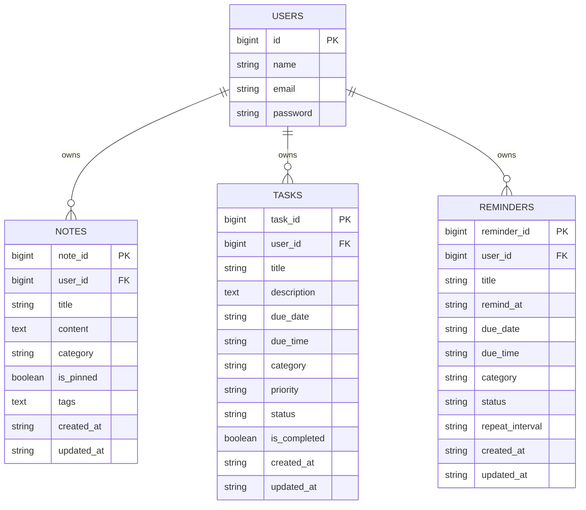
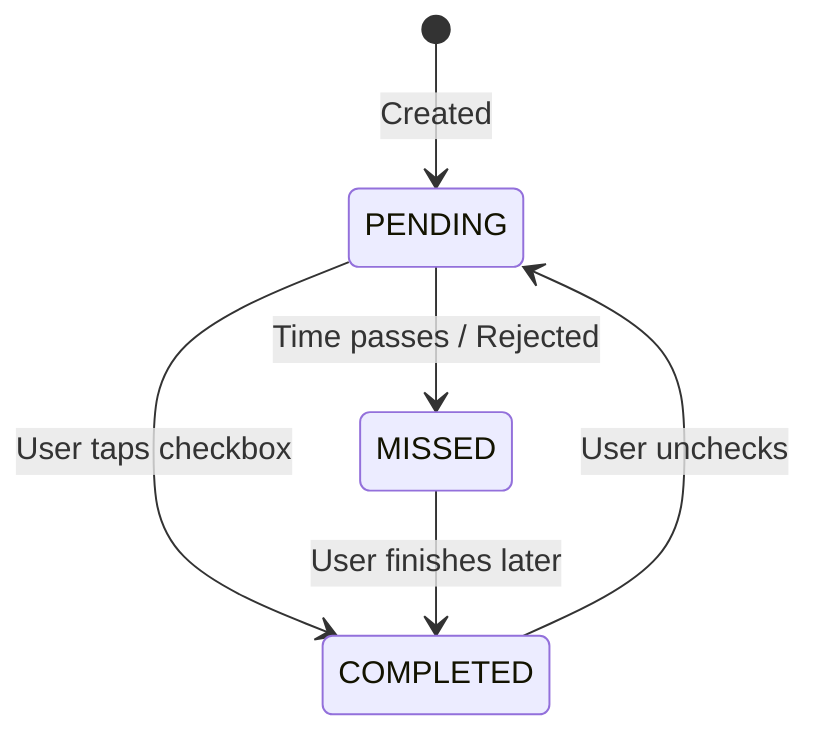

# Daymark Full-Stack Engineering Specification & Implementation Plan
## Feature: Unified Workspace, Tasks, Reminders, Google-Style Speed Dial & Numerical Calendar Counts

> **Document Version**: 1.0.0  
> **Target Audience**: AI Engineering Agents / Senior Software Engineers  
> **Status**: Ready for Implementation (Do NOT modify without running test suites)  
> **Scope**: Backend (`/Backend` - Spring Boot 3.x, MySQL, JPA) and Frontend (`/Frontend` - Flutter 3.x, Riverpod, Drift SQLite, Dio)
> **Master File Location**: `../instruction_work.md` (Repository Root)

---

## 1. Executive Summary & Objective

The Daymark application is expanding from a standalone note-taking app into an integrated personal productivity workspace. This document specifies the complete, production-grade instructions for the next agent to implement:

1. **Backend Tasks & Reminders Subsystem**: Full RESTful APIs, Spring Data JPA entities, repositories, services, and calendar aggregation endpoints.
2. **Calendar Screen Numerical Count Indicators**: Replacing the single dot indicator with numerical count badges reflecting the total active items (Notes + Tasks + Reminders) for every day of the month and week strip.
3. **Tasks & Reminders UI Cards with Dynamic Status Strips**:
   - **Pending/Active**: Distinct **Blue** left edge strip (`#166BBA`).
   - **Completed**: Strip shifts to **Dark Green** (`#0A5B2F`), and title/content get an animated **strikethrough**.
   - **Missed / Rejected**: Strip shifts to **Red** (`#B95E58`).
4. **Merged Bottom Navigation Tab ("Workspace")**: Merging the notes tab into a unified Workspace/Daily hub representing Notes, Tasks, and Reminders with category/type filters.
5. **Google-Style Animated "+ Add" Speed Dial FAB**: Replacing the static "New note" button with a material speed-dial expandable menu revealing options for **New Note**, **New Task**, and **New Reminder**.
6. **Local Drift SQLite Persistence & Offline Sync**: Full offline queuing for Tasks and Reminders matching the existing offline-first note sync architecture.

---

## 2. System Architecture & Entity Relationship Diagram



---

## 3. Backend Implementation Specification (`/Backend`)

### 3.1 Entity Models

#### 3.1.1 Task Entity (`TaskModel.java`)
**Path**: `Backend/src/main/java/com/example/notes_app/tasks/model/TaskModel.java`
```java
package com.example.notes_app.tasks.model;

import com.example.notes_app.auth.model.UserModel;
import com.fasterxml.jackson.annotation.JsonIgnore;
import jakarta.persistence.*;
import lombok.AllArgsConstructor;
import lombok.Data;
import lombok.NoArgsConstructor;

@Data
@Entity
@NoArgsConstructor
@AllArgsConstructor
@Table(name = "tasks")
public class TaskModel {
    @Id
    @GeneratedValue(strategy = GenerationType.IDENTITY)
    private long taskId;

    @Column(name = "title", nullable = false)
    private String title;

    @Column(name = "description", columnDefinition = "TEXT")
    private String description;

    @Column(name = "due_date") // Format: YYYY-MM-DD
    private String dueDate;

    @Column(name = "due_time") // Format: HH:mm
    private String dueTime;

    @Column(name = "category")
    private String category; // e.g. "Work", "Personal", "General"

    @Column(name = "priority")
    private String priority; // "LOW", "MEDIUM", "HIGH"

    @Column(name = "status", nullable = false)
    private String status; // "PENDING", "COMPLETED", "REJECTED", "MISSED"

    @Column(name = "is_completed", nullable = false)
    private boolean isCompleted;

    @Column(name = "created_at")
    private String createdAt;

    @Column(name = "updated_at")
    private String updatedAt;

    @ManyToOne(fetch = FetchType.LAZY)
    @JoinColumn(name = "user_id", nullable = false)
    @JsonIgnore
    private UserModel user;
}
```

#### 3.1.2 Reminder Entity (`ReminderModel.java`)
**Path**: `Backend/src/main/java/com/example/notes_app/reminders/model/ReminderModel.java`
```java
package com.example.notes_app.reminders.model;

import com.example.notes_app.auth.model.UserModel;
import com.fasterxml.jackson.annotation.JsonIgnore;
import jakarta.persistence.*;
import lombok.AllArgsConstructor;
import lombok.Data;
import lombok.NoArgsConstructor;

@Data
@Entity
@NoArgsConstructor
@AllArgsConstructor
@Table(name = "reminders")
public class ReminderModel {
    @Id
    @GeneratedValue(strategy = GenerationType.IDENTITY)
    private long reminderId;

    @Column(name = "title", nullable = false)
    private String title;

    @Column(name = "remind_at", nullable = false) // Format: YYYY-MM-DDTHH:mm:ss
    private String remindAt;

    @Column(name = "due_date") // Format: YYYY-MM-DD for fast calendar queries
    private String dueDate;

    @Column(name = "due_time") // Format: HH:mm
    private String dueTime;

    @Column(name = "category")
    private String category;

    @Column(name = "status", nullable = false)
    private String status; // "PENDING", "COMPLETED", "REJECTED", "MISSED"

    @Column(name = "repeat_interval")
    private String repeatInterval; // "NONE", "DAILY", "WEEKLY", "MONTHLY"

    @Column(name = "created_at")
    private String createdAt;

    @Column(name = "updated_at")
    private String updatedAt;

    @ManyToOne(fetch = FetchType.LAZY)
    @JoinColumn(name = "user_id", nullable = false)
    @JsonIgnore
    private UserModel user;
}
```

#### 3.1.3 Update User Entity (`UserModel.java`)
Add one-to-many cascading mappings:
```java
@OneToMany(mappedBy = "user", cascade = CascadeType.ALL, orphanRemoval = true)
private List<TaskModel> tasks = new ArrayList<>();

@OneToMany(mappedBy = "user", cascade = CascadeType.ALL, orphanRemoval = true)
private List<ReminderModel> reminders = new ArrayList<>();
```

---

### 3.2 Spring Data Repositories

#### 3.2.1 `TaskRepository.java`
**Path**: `Backend/src/main/java/com/example/notes_app/tasks/repository/TaskRepository.java`
```java
package com.example.notes_app.tasks.repository;

import com.example.notes_app.tasks.model.TaskModel;
import org.springframework.data.jpa.repository.JpaRepository;
import org.springframework.data.jpa.repository.Query;
import org.springframework.data.repository.query.Param;
import org.springframework.stereotype.Repository;

import java.util.List;

@Repository
public interface TaskRepository extends JpaRepository<TaskModel, Long> {
    @Query("SELECT t FROM TaskModel t WHERE t.user.id = :userId ORDER BY t.isCompleted ASC, t.dueDate ASC, t.createdAt DESC")
    List<TaskModel> findByUserId(@Param("userId") long userId);

    @Query("SELECT t FROM TaskModel t WHERE t.user.id = :userId AND t.dueDate = :date ORDER BY t.isCompleted ASC, t.dueTime ASC")
    List<TaskModel> findByUserIdAndDueDate(@Param("userId") long userId, @Param("date") String date);

    @Query("SELECT t FROM TaskModel t WHERE t.user.id = :userId AND t.dueDate LIKE CONCAT(:monthPrefix, '%')")
    List<TaskModel> findByUserIdAndMonth(@Param("userId") long userId, @Param("monthPrefix") String monthPrefix);
}
```

#### 3.2.2 `ReminderRepository.java`
**Path**: `Backend/src/main/java/com/example/notes_app/reminders/repository/ReminderRepository.java`
```java
package com.example.notes_app.reminders.repository;

import com.example.notes_app.reminders.model.ReminderModel;
import org.springframework.data.jpa.repository.JpaRepository;
import org.springframework.data.jpa.repository.Query;
import org.springframework.data.repository.query.Param;
import org.springframework.stereotype.Repository;

import java.util.List;

@Repository
public interface ReminderRepository extends JpaRepository<ReminderModel, Long> {
    @Query("SELECT r FROM ReminderModel r WHERE r.user.id = :userId ORDER BY r.status ASC, r.remindAt ASC")
    List<ReminderModel> findByUserId(@Param("userId") long userId);

    @Query("SELECT r FROM ReminderModel r WHERE r.user.id = :userId AND r.dueDate = :date ORDER BY r.dueTime ASC")
    List<ReminderModel> findByUserIdAndDueDate(@Param("userId") long userId, @Param("date") String date);

    @Query("SELECT r FROM ReminderModel r WHERE r.user.id = :userId AND r.dueDate LIKE CONCAT(:monthPrefix, '%')")
    List<ReminderModel> findByUserIdAndMonth(@Param("userId") long userId, @Param("monthPrefix") String monthPrefix);
}
```

---

### 3.3 Enhanced Calendar Aggregation DTO & Service

#### 3.3.1 `CalendarSummaryResponseDto.java` Update
**Path**: `Backend/src/main/java/com/example/notes_app/notes/dto/response/CalendarSummaryResponseDto.java`
```java
package com.example.notes_app.notes.dto.response;

import lombok.AllArgsConstructor;
import lombok.Data;
import lombok.NoArgsConstructor;

import java.util.Map;

@Data
@NoArgsConstructor
@AllArgsConstructor
public class CalendarSummaryResponseDto {
    private int year;
    private int month;
    private int totalItems;
    private int totalNotes;
    private int totalTasks;
    private int totalReminders;
    
    // Date key: YYYY-MM-DD -> total count of all items on that date
    private Map<String, Integer> countsByDate;
    
    // Breakdown per entity type for detailed badges:
    private Map<String, Integer> noteCountsByDate;
    private Map<String, Integer> taskCountsByDate;
    private Map<String, Integer> reminderCountsByDate;
}
```

#### 3.3.2 Unified Day Activity Endpoint (`DayActivityResponseDto.java`)
**Path**: `Backend/src/main/java/com/example/notes_app/notes/dto/response/DayActivityResponseDto.java`
```java
package com.example.notes_app.notes.dto.response;

import com.example.notes_app.notes.model.NotesModel;
import com.example.notes_app.tasks.model.TaskModel;
import com.example.notes_app.reminders.model.ReminderModel;
import lombok.AllArgsConstructor;
import lombok.Data;
import lombok.NoArgsConstructor;

import java.util.List;

@Data
@NoArgsConstructor
@AllArgsConstructor
public class DayActivityResponseDto {
    private String date;
    private int totalCount;
    private List<NotesModel> notes;
    private List<TaskModel> tasks;
    private List<ReminderModel> reminders;
}
```

#### 3.3.3 Updated `getCalendarSummary` in `NotesService.java`
Inject `TaskRepository` and `ReminderRepository` into `NotesService`:
```java
@Transactional
public ResponseEntity<ApiResponse<CalendarSummaryResponseDto>> getCalendarSummary(long userId, int year, int month) {
    String prefix = String.format("%04d-%02d", year, month);
    Map<String, Integer> totalCounts = new HashMap<>();
    Map<String, Integer> noteCounts = new HashMap<>();
    Map<String, Integer> taskCounts = new HashMap<>();
    Map<String, Integer> reminderCounts = new HashMap<>();

    // 1. Process Notes (grouped by original createdAt)
    List<NotesModel> notes = user.getArticles();
    int noteTotal = 0;
    for (NotesModel note : notes) {
        if (note.getCreatedAt() != null && note.getCreatedAt().length() >= 10) {
            String dateKey = note.getCreatedAt().substring(0, 10);
            if (dateKey.startsWith(prefix)) {
                noteCounts.put(dateKey, noteCounts.getOrDefault(dateKey, 0) + 1);
                totalCounts.put(dateKey, totalCounts.getOrDefault(dateKey, 0) + 1);
                noteTotal++;
            }
        }
    }

    // 2. Process Tasks (grouped by dueDate or createdAt)
    List<TaskModel> tasks = taskRepository.findByUserIdAndMonth(userId, prefix);
    int taskTotal = tasks.size();
    for (TaskModel task : tasks) {
        String dateKey = task.getDueDate() != null ? task.getDueDate() : task.getCreatedAt().substring(0, 10);
        taskCounts.put(dateKey, taskCounts.getOrDefault(dateKey, 0) + 1);
        totalCounts.put(dateKey, totalCounts.getOrDefault(dateKey, 0) + 1);
    }

    // 3. Process Reminders (grouped by dueDate)
    List<ReminderModel> reminders = reminderRepository.findByUserIdAndMonth(userId, prefix);
    int reminderTotal = reminders.size();
    for (ReminderModel reminder : reminders) {
        String dateKey = reminder.getDueDate() != null ? reminder.getDueDate() : reminder.getRemindAt().substring(0, 10);
        reminderCounts.put(dateKey, reminderCounts.getOrDefault(dateKey, 0) + 1);
        totalCounts.put(dateKey, totalCounts.getOrDefault(dateKey, 0) + 1);
    }

    int grandTotal = noteTotal + taskTotal + reminderTotal;
    CalendarSummaryResponseDto dto = new CalendarSummaryResponseDto(
        year, month, grandTotal, noteTotal, taskTotal, reminderTotal,
        totalCounts, noteCounts, taskCounts, reminderCounts
    );
    return ResponseEntity.ok(new ApiResponse<>(true, "Calendar summary generated", dto));
}
```

---

### 3.4 REST API Endpoint Matrix

| Method | Endpoint | Description | Request Body / Query | Response DTO |
|---|---|---|---|---|
| `POST` | `/tasks/create-task` | Create new task | `CreateTaskRequestDto` | `ApiResponse<CreateTaskResponseDto>` |
| `GET` | `/tasks/get-all-tasks` | Get all tasks for user | `?userId={id}` | `ApiResponse<List<TaskModel>>` |
| `GET` | `/tasks/get-tasks-by-date` | Get tasks for date | `?userId={id}&date={YYYY-MM-DD}` | `ApiResponse<List<TaskModel>>` |
| `PUT` | `/tasks/update-task` | Update task details | `UpdateTaskRequestDto` | `ApiResponse<TaskModel>` |
| `PUT` | `/tasks/toggle-status` | Toggle complete/missed | `?taskId={id}&status={status}` | `ApiResponse<TaskModel>` |
| `DELETE` | `/tasks/delete-task` | Delete task | `?taskId={id}` | `ApiResponse<Boolean>` |
| `POST` | `/reminders/create-reminder` | Create reminder | `CreateReminderRequestDto` | `ApiResponse<CreateReminderResponseDto>` |
| `GET` | `/reminders/get-all-reminders`| Get all reminders | `?userId={id}` | `ApiResponse<List<ReminderModel>>` |
| `GET` | `/reminders/get-by-date` | Get reminders for date | `?userId={id}&date={YYYY-MM-DD}` | `ApiResponse<List<ReminderModel>>` |
| `PUT` | `/reminders/update-status` | Change reminder status | `?reminderId={id}&status={status}`| `ApiResponse<ReminderModel>` |
| `DELETE` | `/reminders/delete-reminder`| Delete reminder | `?reminderId={id}` | `ApiResponse<Boolean>` |
| `GET` | `/notes/calendar-summary` | Aggregated monthly counts | `?userId={id}&year={y}&month={m}` | `ApiResponse<CalendarSummaryResponseDto>` |
| `GET` | `/notes/day-activity` | All items for date | `?userId={id}&date={YYYY-MM-DD}` | `ApiResponse<DayActivityResponseDto>` |

---

## 4. Frontend Database & Offline Sync Specification (`/Frontend`)

### 4.1 Drift SQLite Database Schema Updates (`app_database.dart`)

**Path**: `Frontend/lib/data/local/database/app_database.dart`

Add tables:
```dart
class CachedTasks extends Table {
  IntColumn get id => integer().autoIncrement()();
  IntColumn get userId => integer()();
  IntColumn get serverId => integer().nullable()();
  TextColumn get title => text()();
  TextColumn get description => text().nullable()();
  TextColumn get dueDate => text().nullable()(); // YYYY-MM-DD
  TextColumn get dueTime => text().nullable()(); // HH:mm
  TextColumn get category => text().nullable()();
  TextColumn get priority => text().withDefault(const Constant('MEDIUM'))();
  TextColumn get status => text().withDefault(const Constant('PENDING'))(); // PENDING, COMPLETED, REJECTED, MISSED
  BoolColumn get isCompleted => boolean().withDefault(const Constant(false))();
  TextColumn get createdAt => text().nullable()();
  TextColumn get updatedAt => text().nullable()();
  BoolColumn get isPending => boolean().withDefault(const Constant(false))();

  @override
  List<Set<Column<Object>>> get uniqueKeys => [
    {userId, serverId},
  ];
}

class PendingTasks extends Table {
  IntColumn get id => integer().autoIncrement()();
  IntColumn get userId => integer()();
  IntColumn get localTaskId => integer()();
  TextColumn get payload => text()();
  DateTimeColumn get queuedAt => dateTime().withDefault(currentDateAndTime)();

  @override
  List<Set<Column<Object>>> get uniqueKeys => [
    {localTaskId},
  ];
}

class CachedReminders extends Table {
  IntColumn get id => integer().autoIncrement()();
  IntColumn get userId => integer()();
  IntColumn get serverId => integer().nullable()();
  TextColumn get title => text()();
  TextColumn get remindAt => text()(); // ISO-8601
  TextColumn get dueDate => text().nullable()(); // YYYY-MM-DD
  TextColumn get dueTime => text().nullable()(); // HH:mm
  TextColumn get category => text().nullable()();
  TextColumn get status => text().withDefault(const Constant('PENDING'))();
  TextColumn get repeatInterval => text().withDefault(const Constant('NONE'))();
  TextColumn get createdAt => text().nullable()();
  TextColumn get updatedAt => text().nullable()();
  BoolColumn get isPending => boolean().withDefault(const Constant(false))();

  @override
  List<Set<Column<Object>>> get uniqueKeys => [
    {userId, serverId},
  ];
}

class PendingReminders extends Table {
  IntColumn get id => integer().autoIncrement()();
  IntColumn get userId => integer()();
  IntColumn get localReminderId => integer()();
  TextColumn get payload => text()();
  DateTimeColumn get queuedAt => dateTime().withDefault(currentDateAndTime)();

  @override
  List<Set<Column<Object>>> get uniqueKeys => [
    {localReminderId},
  ];
}
```

Update `@DriftDatabase`:
```dart
@DriftDatabase(tables: [
  CachedNotes,
  PendingNotes,
  CachedProfiles,
  CachedTasks,
  PendingTasks,
  CachedReminders,
  PendingReminders,
])
class AppDatabase extends _$AppDatabase {
  @override
  int get schemaVersion => 2;

  @override
  MigrationStrategy get migration => MigrationStrategy(
    onCreate: (m) => m.createAll(),
    onUpgrade: (m, from, to) async {
      if (from < 2) {
        await m.createTable(cachedTasks);
        await m.createTable(pendingTasks);
        await m.createTable(cachedReminders);
        await m.createTable(pendingReminders);
      }
    },
  );
  ...
}
```

---

## 5. Frontend UI & Interaction Architecture

### 5.1 Merged Bottom Navigation Bar ("Workspace")

**Target File**: `Frontend/lib/views/screens/dashboard/dashboard_screen.dart`

1. Update bottom navigation tab definitions:
   - **Tab 0**: Label changed from `"Notes"` to **`"Workspace"`** (or `"Daily"`).
   - Icon changed to a composite/merged icon representing notes + checklist.
   - **Tab 1**: `"Calendar"` (`AppIcons.navCalendar`).
   - **Tab 2**: `"Profile"` (`AppIcons.navProfile`).
2. Top Segmented Filter in Workspace (`home_screen.dart`):
   - Add segmented chips at the top under search:
     `[ All ]` `[ Notes ]` `[ Tasks ]` `[ Reminders ]`
   - Filter seamlessly displays matching items in a unified feed.

---

### 5.2 Google-Style Expandable "+ Add" Speed Dial FAB

**Target File**: `Frontend/lib/views/screens/home/widgets/notes_floating_action_button.dart` & `home_screen.dart`

```
         [ ( ) New Reminder ]   <- Indigo/Purple icon + Pill
         [ ( ) New Task ]       <- Blue icon + Pill
         [ ( ) New Note ]       <- Yellow/Cream icon + Pill
         [    + Add    ]        <- Main FAB (rotates 45 deg to 'x' on open)
```

#### Specification & Motion:
1. **Collapsed State**:
   - Label: `+ Add`
   - Icon: `Icons.add_rounded` (rotates to 45° 'x' when opened).
   - Dimensions: Height `48.h`, pill border radius `18.r`.
   - Palette: `palette.accent` / `palette.ink`.
2. **Expanded State**:
   - Background Scrim: `Colors.black.withOpacity(0.35)` with tap-to-dismiss.
   - Staggered vertical animation (Duration: 220ms, Curve: `Curves.easeOutBack`).
   - Three Speed Dial Items:
     1. **New Note**: Yellow/Cream accent icon, label `"Note"`. Opens `NoteDetailsScreen()`.
     2. **New Task**: Blue accent icon (`#166BBA`), label `"Task"`. Opens `TaskDetailsModal()`.
     3. **New Reminder**: Purple accent icon (`#4A2D94`), label `"Reminder"`. Opens `ReminderDetailsModal()`.

---

### 5.3 Task & Reminder Cards with Status Strip & Strikethrough

**Target Files**:
- `Frontend/lib/views/screens/home/widgets/task_item_card.dart`
- `Frontend/lib/views/screens/home/widgets/reminder_item_card.dart`

#### Color & Typography State Machine:



| State | Strip Color Token | Left Strip Hex | Title Typography | Background | Checkbox / Icon State |
|---|---|---|---|---|---|
| **PENDING** | Active Blue | `#166BBA` | `FontWeight.w700`, Normal Text | `palette.surface` | Empty circle / Outline box |
| **COMPLETED**| Dark Green | `#0A5B2F` | `lineThrough`, `palette.muted` | `palette.surface` | Checked circle with check icon |
| **MISSED / REJECTED** | Danger Red | `#B95E58` | `FontWeight.w600`, Red pill tag | `palette.surface` | Alert outline icon / X mark |

#### Card Implementation Pattern:
```dart
Widget taskItemCard({
  required BuildContext context,
  required TaskItem task,
  required ValueChanged<bool> onToggleComplete,
  required VoidCallback onTap,
}) {
  final palette = context.daymark;
  
  Color stripColor;
  if (task.status == 'COMPLETED' || task.isCompleted) {
    stripColor = const Color(0xFF0A5B2F); // Dark Green
  } else if (task.status == 'MISSED' || task.status == 'REJECTED') {
    stripColor = const Color(0xFFB95E58); // Danger Red
  } else {
    stripColor = const Color(0xFF166BBA); // Primary Blue
  }

  final isDone = task.isCompleted || task.status == 'COMPLETED';

  return Container(
    margin: EdgeInsets.only(bottom: 10.h),
    decoration: BoxDecoration(
      color: palette.surface,
      borderRadius: BorderRadius.circular(16.r),
      border: Border.all(color: palette.line),
    ),
    child: ClipRRect(
      borderRadius: BorderRadius.circular(16.r),
      child: IntrinsicHeight(
        child: Row(
          crossAxisAlignment: CrossAxisAlignment.stretch,
          children: [
            // Left Status Strip
            Container(width: 5.w, color: stripColor),
            
            // Card Content
            Expanded(
              child: Padding(
                padding: EdgeInsets.symmetric(horizontal: 14.w, vertical: 12.h),
                child: Row(
                  children: [
                    // Checkbox
                    Checkbox(
                      value: isDone,
                      activeColor: const Color(0xFF0A5B2F),
                      onChanged: (val) => onToggleComplete(val ?? false),
                    ),
                    SizedBox(width: 8.w),
                    // Title & Description
                    Expanded(
                      child: Column(
                        crossAxisAlignment: CrossAxisAlignment.start,
                        children: [
                          Text(
                            task.title,
                            style: GoogleFonts.inter(
                              fontSize: 15.sp,
                              fontWeight: FontWeight.w700,
                              color: isDone ? palette.muted : palette.ink,
                              decoration: isDone ? TextDecoration.lineThrough : null,
                            ),
                          ),
                          if (task.dueTime != null || task.dueDate != null) ...[
                            SizedBox(height: 4.h),
                            Text(
                              "${task.dueDate ?? ''} ${task.dueTime ?? ''}",
                              style: GoogleFonts.inter(fontSize: 11.sp, color: palette.muted),
                            ),
                          ],
                        ],
                      ),
                    ),
                  ],
                ),
              ),
            ),
          ],
        ),
      ),
    ),
  );
}
```

---

### 5.4 Calendar Screen: Numerical Count Badges (Replacing Dots)

**Target File**: `Frontend/lib/views/screens/calendar/calendar_screen.dart`

#### Design Transformation:
- **Existing**: 3.5px dot at the bottom of the date cell.
- **New Requirement**: Dedicated **Numerical Count Badge** displaying the total count of active notes, tasks, and reminders for that date.

#### Day Cell Layout:
```dart
Widget _buildCalendarDayCell({
  required String dayText,
  required DateTime date,
  required int activityCount, // notes + tasks + reminders count
  required bool isCurrentMonth,
  required bool isSelected,
  required VoidCallback? onTap,
  required DaymarkPalette palette,
}) {
  final isDark = palette.brightness == Brightness.dark;

  return GestureDetector(
    onTap: onTap,
    behavior: HitTestBehavior.opaque,
    child: Center(
      child: Container(
        width: 34.r,
        height: 38.h,
        decoration: BoxDecoration(
          color: isSelected
              ? (isDark ? palette.accent : palette.ink)
              : Colors.transparent,
          borderRadius: BorderRadius.circular(10.r),
        ),
        child: Column(
          mainAxisAlignment: MainAxisAlignment.center,
          children: [
            // Day Number
            Text(
              dayText,
              style: GoogleFonts.inter(
                fontSize: 12.sp,
                fontWeight: isSelected ? FontWeight.w800 : FontWeight.w500,
                color: isSelected
                    ? (isDark ? palette.background : palette.surface)
                    : (isCurrentMonth
                        ? palette.ink
                        : palette.muted.withValues(alpha: 0.4)),
              ),
            ),
            SizedBox(height: 2.h),
            
            // Numerical Count Badge (Replaces Dot)
            if (activityCount > 0)
              Container(
                padding: EdgeInsets.symmetric(horizontal: 4.w, vertical: 1.h),
                decoration: BoxDecoration(
                  color: isSelected
                      ? (isDark ? Colors.black.withOpacity(0.25) : Colors.white.withOpacity(0.25))
                      : palette.accentSoft,
                  borderRadius: BorderRadius.circular(6.r),
                  border: Border.all(
                    color: isSelected ? Colors.transparent : palette.accent.withOpacity(0.3),
                    width: 0.8,
                  ),
                ),
                child: Text(
                  activityCount > 9 ? "9+" : "$activityCount",
                  style: GoogleFonts.inter(
                    fontSize: 9.sp,
                    fontWeight: FontWeight.w800,
                    color: isSelected
                        ? (isDark ? palette.background : palette.surface)
                        : palette.accent,
                  ),
                ),
              )
            else
              SizedBox(height: 12.h), // Placeholder for vertical alignment
          ],
        ),
      ),
    ),
  );
}
```

---

## 6. Phased Implementation Roadmap for Next Agent

### Phase 1: Backend Database & Entities
1. Create `TaskModel.java` in `com.example.notes_app.tasks.model`.
2. Create `ReminderModel.java` in `com.example.notes_app.reminders.model`.
3. Update `UserModel.java` with `@OneToMany` collections for tasks and reminders.
4. Verify MySQL auto-ddl generates `tasks` and `reminders` tables cleanly.

### Phase 2: Backend Repositories, Services & APIs
1. Create `TaskRepository.java` and `ReminderRepository.java`.
2. Create `CreateTaskRequestDto.java`, `UpdateTaskRequestDto.java`.
3. Create `CreateReminderRequestDto.java`, `UpdateReminderRequestDto.java`.
4. Create `TaskService.java` & `TaskController.java` with full CRUD endpoints.
5. Create `ReminderService.java` & `ReminderController.java`.
6. Update `NotesService.getCalendarSummary` to aggregate Note + Task + Reminder counts.
7. Run `mvn clean test` in `/Backend`.

### Phase 3: Frontend Drift SQLite DB Schema & Migration
1. Add `CachedTasks`, `PendingTasks`, `CachedReminders`, `PendingReminders` tables to `lib/data/local/database/app_database.dart`.
2. Increment `schemaVersion` to 2 and add `MigrationStrategy` handling table creation.
3. Add helper query methods for tasks and reminders.
4. Run `flutter pub run build_runner build --delete-conflicting-outputs`.

### Phase 4: Frontend Network Layer & Repositories
1. Add endpoints in `lib/data/network/api/api_endpoints.dart`.
2. Implement methods in `lib/data/network/api/api_client.dart`.
3. Create `TaskRepo` (`lib/data/repository/task/task_repo.dart`) and register in `dependency_injection.dart`.
4. Create `ReminderRepo` (`lib/data/repository/reminder/reminder_repo.dart`) and register in `dependency_injection.dart`.
5. Update `OfflineSyncService` to sync `PendingTasks` and `PendingReminders`.

### Phase 5: Frontend ViewModels & Controllers
1. Create `TaskViewmodel` (`lib/viewmodel/task/task_viewmodel.dart`).
2. Create `ReminderViewmodel` (`lib/viewmodel/reminder/reminder_viewmodel.dart`).
3. Update `controllers.dart` with providers.

### Phase 6: Frontend UI Components & Screens
1. **Speed Dial FAB**: Update `notes_floating_action_button.dart` to support material speed dial with "+ Add", scrim, and 3 option pills.
2. **Cards with Status Strip**:
   - Create `task_item_card.dart` with Blue (Pending), Dark Green (Completed), Red (Missed).
   - Create `reminder_item_card.dart` with same status strip rules.
3. **Workspace Tab**: Update `dashboard_screen.dart` tab 0 label to "Workspace".
4. **Calendar Numerical Counts**: Update `calendar_screen.dart` to calculate aggregated items per date and display numerical badges instead of dots.

### Phase 7: Verification & Testing
1. Execute `test/note_export_import_test.dart` and `test/daymark_design_test.dart`.
2. Add new unit tests for `TaskRepo`, `ReminderRepo`, and `SpeedDialFab`.
3. Run `flutter test` across whole test suite (expect 100% pass).
4. Run `flutter analyze` ensuring zero warnings.

---

## 7. Verification Checklist for Sign-Off

- [ ] Backend Spring Boot compiles with `mvn clean test` without errors.
- [ ] MySQL tables `tasks` and `reminders` created with correct foreign keys.
- [ ] `/notes/calendar-summary` returns numerical totals combining notes, tasks, and reminders.
- [ ] Calendar day cells render numerical badges (e.g. `2`, `5`, `9+`) instead of 3.5px dots.
- [ ] Week strip horizontal pills show numerical count below weekday names.
- [ ] Bottom navigation tab 0 is renamed and styled as "Workspace".
- [ ] Floating action button is "+ Add" and smoothly expands Google-style option pills.
- [ ] Tasks and Reminders display the **Blue** strip when Pending.
- [ ] When completed, strip turns **Dark Green** and title gets strikethrough.
- [ ] When missed or rejected, strip turns **Red**.
- [ ] Offline creation queues in Drift SQLite and syncs when connectivity returns.
- [ ] Full Flutter test suite (`flutter test`) passes completely.
